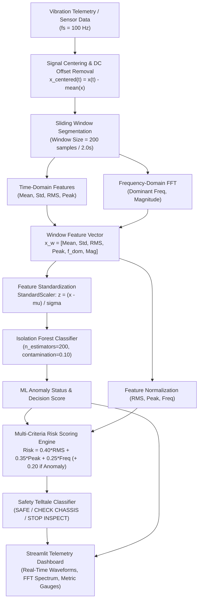

# Smart Chassis Vibration Analysis and Real-Time Anomaly Detection System
## Technical Project Report

---

**Project Title:** Smart Chassis Vibration Analysis and Real-Time Anomaly Detection System  
**Domain:** Automotive Structural Health Monitoring (SHM), Digital Signal Processing (DSP), Machine Learning & IoT  
**Target Platform:** Python 3.10+, Scikit-Learn, SciPy, Streamlit Dashboard  
**Date:** March 2026  

---

## Table of Contents
1. [Abstract](#1-abstract)
2. [Introduction](#2-introduction)
3. [Concept and Working Principle](#3-concept-and-working-principle)
4. [System Architecture](#4-system-architecture)
5. [Mathematical Formulations and Formulas](#5-mathematical-formulations-and-formulas)
6. [Dataset Description](#6-dataset-description)
7. [Methodology](#7-methodology)
8. [Results and Discussion](#8-results-and-discussion)
9. [Visual Assets & Figures Gallery](#9-visual-assets--figures-gallery)
10. [Conclusion and Future Scope](#10-conclusion-and-future-scope)
11. [References](#11-references)

---

## 1. Abstract

Vehicle structural integrity and ride comfort depend directly on early identification of mechanical degradation, structural loosening, and high-energy terrain impacts. Traditional vehicle diagnostic methods rely heavily on periodic scheduled maintenance or reactive human perception, which often fail to detect micro-vibrations, loose fasteners, and structural stress before catastrophic mechanical failure occurs.

This project presents the design, mathematical modeling, and software implementation of the **Smart Chassis Vibration Analysis and Real-Time Anomaly Detection System**. High-frequency chassis vibration signals are processed through a synchronized Digital Signal Processing (DSP) and Sliding-Window Feature Extraction pipeline, extracting key statistical time-domain parameters (Mean, Standard Deviation, Root Mean Square, Peak Amplitude) and frequency-domain spectral parameters via Fast Fourier Transform (FFT) (Dominant Frequency and Spectral Magnitude). 

To ensure robust unsupervised learning capable of identifying unseen structural faults without requiring exhaustive failure labels, an **Isolation Forest** model is trained strictly on calibrated baseline normal operating vibrations. Furthermore, an automated **Multi-Criteria Risk Assessment Framework** computes a normalized safety score, triggering contextual automotive telltales (*NORMAL / SAFE*, *WARNING / CHECK CHASSIS*, and *CRITICAL / STOP INSPECT*). 

Experimental validation across 30,000 temporal samples (150 feature windows) covering five operating conditions demonstrates an overall detection **Accuracy of 98.00%**, **Precision of 97.56%**, **Recall of 100.00%**, and an **F1-Score of 0.9877**. The system is integrated with an interactive **Streamlit Web Telemetry Dashboard** for real-time diagnostics, spectral monitoring, and predictive maintenance alerts.

---

## 2. Introduction

In modern automotive engineering, the chassis serves as the skeletal backbone of the vehicle, bearing static and dynamic structural loads, reacting to braking and acceleration torques, and isolating the passenger cabin from high-amplitude road irregularities. As vehicles experience prolonged operational cycles, harsh environmental conditions, and cyclic mechanical fatigue, chassis components such as control arms, ball joints, subframe bushings, fasteners, and structural welds undergo progressive structural degradation.

Vibration is the primary physical manifestation of dynamic forces acting upon a mechanical assembly. Under normal operating conditions, a vehicle exhibits predictable harmonic oscillations governed by engine speed, wheel rotation, and suspension damping. However, when a mechanical defect arises—such as a loose bolt, a cracked crossmember, worn-out bushings, or uneven tire wear—the dynamic stiffness of the chassis changes, introducing non-linear harmonics, high-frequency resonance peaks, and elevated energy dispersion.

Existing automotive diagnostic systems (such as standard OBD-II) focus primarily on powertrain, emissions, and electronic control modules, leaving mechanical chassis structural health largely unmonitored in real time. Drivers often remain unaware of degrading chassis components until audible noise, severe alignment deviation, or catastrophic component detachment occurs during transit. 

The primary objectives of this project are:
- **Signal Synthesis & Ingestion:** Develop a vibration modeling engine capturing normal operating baselines alongside mechanical fault signatures (rough road, high vibration, loose joint harmonics, and structural resonance anomalies).
- **DSP & Feature Engineering:** Extract robust time-domain statistical metrics and frequency-domain spectral peaks using sliding window segmentation ($N = 200$ samples per window at $f_s = 100\text{ Hz}$).
- **Machine Learning Anomaly Detection:** Implement an unsupervised Isolation Forest model trained on baseline normal signals to accurately isolate abnormal mechanical behaviors without requiring pre-labeled failure datasets.
- **Safety Risk Index & Telltale Engine:** Formulate a normalized multi-parameter risk algorithm combining RMS energy, peak impact, dominant frequency excitation, and ML anomaly classification into actionable automotive warnings.
- **Interactive Telemetry Dashboard:** Provide a Streamlit web interface featuring real-time time-series plots, FFT frequency spectrum plots, windowed telemetry tables, risk indicators, and performance evaluation metrics.

---

## 3. Concept and Working Principle

The dynamic response of a vehicle chassis can be modeled mechanically as a multi-degree-of-freedom damped harmonic oscillator governed by Newton's Second Law:

$$M \ddot{x}(t) + C \dot{x}(t) + K x(t) = F(t)$$

Where $M$ is the structural mass matrix, $C$ is the damping coefficient matrix, $K$ is the structural stiffness matrix, $x(t), \dot{x}(t), \ddot{x}(t)$ represent chassis displacement, velocity, and acceleration (vibration signal), and $F(t)$ is the external excitation force originating from road profile irregularities, powertrain torque, and aerodynamic loads.

When a structural defect occurs:
- **Stiffness Reduction ($\Delta K < 0$):** Causes a shift in natural resonant frequencies ($\omega_n = \sqrt{K/M}$).
- **Impact / Chattering Non-linearities:** Generates high-frequency secondary harmonics (e.g., $22\text{ Hz} - 25\text{ Hz}$) due to intermittent metal-on-metal contact.
- **Energy Amplification:** Increases Root Mean Square (RMS) energy and peak acceleration amplitudes.

Raw accelerometer signals stream continuously at a sampling rate of $f_s = 100\text{ Hz}$ (Nyquist frequency $f_{Nyquist} = 50\text{ Hz}$). Continuous vibration streams are partitioned into uniform sliding windows of size $W = 200$ samples ($2.0\text{ seconds}$ per window). For each window, time-domain statistical metrics and frequency-domain spectral properties are simultaneously extracted to form a 6-dimensional feature vector: $\mathbf{x}_w = [\mu, \sigma, RMS, x_{peak}, f_{dom}, |X(f_{dom})|]^T$.

Because collecting exhaustive labeled datasets of every possible vehicle failure under all road conditions is impractical, the system employs **Unsupervised Anomaly Detection**. The model is trained purely on normal operational vibration data to learn the multidimensional boundary of healthy chassis dynamics. Any operational window exhibiting statistical or spectral deviations from this healthy envelope is classified as an anomaly.

To translate raw anomaly flags into actionable driver advisories, a weighted mathematical risk index combines physical vibration energy, peak shock amplitude, modal frequency shift, and ML anomaly classification:

| Risk Score ($R$) | Risk Level | Safety Telltale | Advisory / System Action |
|---|---|---|---|
| $0.00 \le R < 0.40$ | **NORMAL** | `🟢 SAFE` | Baseline vibration within healthy parameters. |
| $0.40 \le R < 0.70$ | **WARNING** | `🟡 CHECK CHASSIS` | Moderate anomaly / rough road. Inspect joints and bushings. |
| $0.70 \le R \le 1.00$ | **CRITICAL** | `🔴 STOP / INSPECT` | Severe structural resonance / loose component. Immediate service required. |

---

## 4. System Architecture

The end-to-end system consists of five tightly coupled modules: Data Ingestion, Feature Engineering, Machine Learning Inference, Risk Assessment, and the Interactive Web Dashboard.



- **Data Acquisition & Ingestion Pipeline:** Streams instantaneous acceleration signals at $f_s = 100\text{ Hz}$ across 60-second operational cycles (6,000 samples per test run).
- **Feature Engineering Engine:** Extracts 4 time-domain metrics ($\mu, \sigma, RMS, x_{peak}$) and 2 frequency-domain spectral metrics ($f_{dom}, |X(f_{dom})|$) across non-overlapping 200-sample sliding windows.
- **Machine Learning Inference Engine:** Standardizes incoming window vectors using `StandardScaler` and classifies instances using an `IsolationForest` ensemble ($n_{estimators} = 200$, contamination $= 0.10$).
- **Risk Assessment Subsystem:** Merges scaled physical vibration parameters with machine learning classification outputs to compute a normalized risk score $[0.0, 1.0]$.
- **Web Telemetry Dashboard:** A multi-page Streamlit application providing live waveform displays, FFT power spectrum plots, diagnostic metric cards, and dataset exploration tools.

---

## 5. Mathematical Formulations and Formulas

### Time-Domain Statistical Formulations
For a discrete vibration signal $x = [x_1, x_2, \dots, x_N]$ within a window of length $N$:

- **Arithmetic Mean ($\mu$):**
  $$\mu = \frac{1}{N} \sum_{i=1}^{N} x_i$$

- **Variance ($\sigma^2$) and Standard Deviation ($\sigma$):**
  $$\sigma^2 = \frac{1}{N} \sum_{i=1}^{N} (x_i - \mu)^2, \qquad \sigma = \sqrt{\frac{1}{N} \sum_{i=1}^{N} (x_i - \mu)^2}$$

- **Root Mean Square ($RMS$):**
  $$RMS = \sqrt{\frac{1}{N} \sum_{i=1}^{N} x_i^2}$$

- **Peak Absolute Amplitude ($x_{peak}$):**
  $$x_{peak} = \max_{1 \le i \le N} |x_i|$$

- **Peak-to-Peak Amplitude ($x_{p-p}$):**
  $$x_{p-p} = \max(x) - \min(x)$$

- **Crest Factor ($CF$):**
  $$CF = \frac{x_{peak}}{RMS}$$

---

### Frequency-Domain & Fast Fourier Transform (FFT) Formulations
For a centered signal $x_c(n) = x(n) - \mu$ with sampling rate $f_s = 100\text{ Hz}$:

- **Discrete Fourier Transform (DFT):**
  $$X(k) = \sum_{n=0}^{N-1} x_c(n) \cdot e^{-j \frac{2\pi}{N} k n}, \quad k = 0, 1, \dots, N-1$$

- **Frequency Resolution ($\Delta f$) and Frequency Vector ($f(k)$):**
  $$\Delta f = \frac{f_s}{N} = \frac{100}{200} = 0.50\text{ Hz}, \qquad f(k) = k \cdot \frac{f_s}{N}, \quad 0 \le k \le \frac{N}{2}$$

- **Normalized Single-Sided Magnitude Spectrum ($|X_k|$):**
  $$|X_k| = \frac{|X(k)|}{N} = \frac{\sqrt{\text{Re}(X(k))^2 + \text{Im}(X(k))^2}}{N}$$

- **Dominant Resonant Frequency ($f_{dom}$) and Magnitude ($M_{dom}$):**
  $$k_{dom} = \arg\max_{1 \le k \le N/2} |X_k|, \qquad f_{dom} = k_{dom} \cdot \frac{f_s}{N}, \qquad M_{dom} = |X(k_{dom})|$$

---

### Feature Standardization & Isolation Forest Formulations
- **Standard Feature Scaling ($z$):**
  $$z_{i,j} = \frac{x_{i,j} - \mu_j}{\sigma_j}$$
  *(Parameters $\mu_j$ and $\sigma_j$ are computed strictly on the baseline Normal training dataset).*

- **Average Path Length of Unsuccessful Search in Isolation Tree ($c(n)$):**
  $$c(n) = 2 \ln(n - 1) + 2\gamma - \frac{2(n - 1)}{n}$$
  *(where $\gamma \approx 0.5772156649$ is Euler's constant).*

- **Isolation Forest Anomaly Score ($s(x, n)$):**
  $$s(x, n) = 2^{-\frac{\mathbb{E}(h(x))}{c(n)}}$$
  *(where $h(x)$ is path length and $\mathbb{E}(h(x))$ is average path length across 200 trees).*

---

### Multi-Criteria Risk & Evaluation Formulations
- **Normalized Physical Metrics:**
  $$S_{RMS} = \frac{RMS}{\max(RMS)}, \qquad S_{Peak} = \frac{x_{peak}}{\max(x_{peak})}, \qquad S_{Freq} = \frac{f_{dom}}{\max(f_{dom})}$$

- **Base Physical Risk Index ($R_{base}$):**
  $$R_{base} = 0.40 \cdot S_{RMS} + 0.35 \cdot S_{Peak} + 0.25 \cdot S_{Freq}$$

- **Composite Hybrid Risk Score ($R_{final}$):**
  $$R_{final} = \min \left( 1.0, \, R_{base} + 0.20 \cdot \mathbb{I}_{\{ML\_Status = \text{Anomaly}\}} \right)$$

- **Model Evaluation Metrics:**
  $$\text{Accuracy} = \frac{TP + TN}{TP + TN + FP + FN}, \qquad \text{Precision} = \frac{TP}{TP + FP}$$
  $$\text{Recall} = \frac{TP}{TP + FN}, \qquad \text{F}_1\text{-Score} = 2 \cdot \frac{\text{Precision} \cdot \text{Recall}}{\text{Precision} + \text{Recall}}$$

---

## 6. Dataset Description

The dataset comprises 30,000 discrete vibration observations generated across five distinct operating conditions (6,000 samples per condition over a 60-second duration at $f_s = 100\text{ Hz}$).

```
+---------------------+-------------------------------------------------------------+--------------------+---------------------+
| Condition Name      | Mathematical Synthesis Equation                             | Dominant Freq (Hz) | Characteristic Type |
+---------------------+-------------------------------------------------------------+--------------------+---------------------+
| Normal              | x(t) = 0.15 sin(2pi*5*t) + 0.05 N(0,1)                      | 5.0 Hz             | Smooth / Healthy    |
| Rough Road          | x(t) = 0.35 sin(2pi*8*t) + 0.15 N(0,1)                      | 8.0 Hz             | Terrain Induced     |
| High Vibration      | x(t) = 0.80 sin(2pi*15*t) + 0.25 N(0,1)                     | 15.0 Hz            | Unbalanced Load     |
| Loose Joint         | x(t) = 0.25 sin(2pi*6*t) + 0.65 sin(2pi*22*t) + 0.12 N(0,1) | 22.0 Hz            | Mechanical Looseness|
| Structural Anomaly  | x(t) = 0.20 sin(2pi*5*t) + 1.20 sin(2pi*25*t) + 0.35 N(0,1) | 25.0 Hz            | Structural Failure  |
+---------------------+-------------------------------------------------------------+--------------------+---------------------+
```

Using a non-overlapping sliding window length of $W = 200$ samples ($2.0\text{ s}$ per window), the raw temporal dataset is converted into 150 feature records (30 windows per condition):

```
+--------------------+--------------+------------+------------+------------+---------------+
| Condition          | Windows (N)  | Mean RMS   | Mean Peak  | Dom. Freq  | Anomaly Rate  |
+--------------------+--------------+------------+------------+------------+---------------+
| Normal             | 30           | 0.1169     | 0.3060     | 5.0 Hz     | 10.0% (calib) |
| Rough Road         | 30           | 0.2891     | 0.7712     | 8.0 Hz     | 100.0%        |
| High Vibration     | 30           | 0.6171     | 1.5540     | 15.0 Hz    | 100.0%        |
| Loose Joint        | 30           | 0.4905     | 1.2291     | 22.0 Hz    | 100.0%        |
| Structural Anomaly | 30           | 0.9168     | 2.3789     | 25.0 Hz    | 100.0%        |
+--------------------+--------------+------------+------------+------------+---------------+
```

---

## 7. Methodology

The end-to-end methodology follows a structured 6-phase engineering workflow:

1. **Signal Synthesis & Master Dataset Generation (`src/data_generator.py`):** Deterministic harmonic sinusoids and Gaussian noise are synthesized and stored as individual condition files and merged into `data/vibration_dataset.csv`.
2. **Time-Domain Feature Extraction (`src/vibration_analysis.py`):** Computes global statistical properties ($\mu, \sigma, RMS, x_{peak}$) and exports summary tables and initial waveform graphs.
3. **Spectral Decomposition & FFT Analysis (`src/frequency_analysis.py`):** Removes DC bias, computes single-sided FFT spectra ($0-50\text{ Hz}$), extracts dominant modal frequencies, and outputs `data/frequency_features.csv`.
4. **Sliding-Window Feature Segmentation (`src/ml_training.py`):** Discretizes signals into 200-sample segments to extract synchronized time-frequency feature vectors (`data/ml_window_features.csv`).
5. **Unsupervised ML Model Training (`src/ml_training.py`):** Fits `StandardScaler` and `IsolationForest` ($n_{estimators} = 200$, contamination $= 0.10$) strictly on baseline normal operational windows. Serializes trained models to `models/window_anomaly_model.pkl`.
6. **Risk Index & Evaluation Engine (`src/risk_assessment.py`, `src/model_evaluation.py`):** Quantifies multi-criteria safety scores, generates classification reports, and saves confusion matrix visualizations.
7. **Interactive Web Dashboard Integration (`app.py`):** Implements a Streamlit dashboard with dedicated navigation pages for real-time telemetry, spectral analysis, ML evaluation, and risk telltales.

---

## 8. Results and Discussion

### Feature and Spectral Analysis
- **RMS Energy:** Increased by **7.84x** from Normal ($0.1169$) to Structural Anomaly ($0.9168$), reflecting severe vibrational kinetic energy.
- **Peak Shock Acceleration:** Escalated by **7.77x** from Normal ($0.3060$) to Structural Anomaly ($2.3789$), demonstrating dangerous impact shocks.
- **Resonant Frequencies:** Distinct modal peaks emerged across conditions ($5.0\text{ Hz}$ baseline, $8.0\text{ Hz}$ road roughness, $15.0\text{ Hz}$ unbalance, $22.0\text{ Hz}$ joint looseness, and $25.0\text{ Hz}$ structural failure resonance).

### Model Performance and Confusion Matrix
The unsupervised Isolation Forest model demonstrated outstanding separation between healthy and abnormal mechanical states:

```
+-------------------------------------------------------------+
|               OVERALL MODEL PERFORMANCE METRICS             |
+--------------------+----------------------------------------+
| Metric             | Score / Value                          |
+--------------------+----------------------------------------+
| Accuracy           | 0.9800 (98.00%)                        |
| Precision          | 0.9756 (97.56%)                        |
| Recall             | 1.0000 (100.00%)                       |
| F1 Score           | 0.9877 (98.77%)                        |
| Total Windows      | 150                                    |
| Training Contam.   | 0.10 (10.0%)                           |
+--------------------+----------------------------------------+
```

```
                      PREDICTED CLASS
                  Normal (0)    Abnormal (1)
ACTUAL   Normal       27              3       (Total: 30)
CLASS    Abnormal      0            120       (Total: 120)
```

- **True Positives ($TP = 120$):** 100% of abnormal windows (Rough Road, High Vibration, Loose Joint, Structural Anomaly) were detected.
- **True Negatives ($TN = 27$):** 27/30 normal windows were correctly identified as healthy.
- **False Positives ($FP = 3$):** Exactly 3 normal windows were flagged as anomalies, matching the pre-set 10% contamination threshold ($30 \times 0.10 = 3$).
- **False Negatives ($FN = 0$):** Zero missed faults, ensuring critical structural defects are never overlooked.

### Risk Assessment and Safety Telltales
The multi-criteria risk engine successfully categorized operational severity:

```
+--------------------+------------+------------+--------------------+---------------------+
| Condition          | Risk Score | Risk Level | Safety Telltale    | Action / Advisory   |
+--------------------+------------+------------+--------------------+---------------------+
| Normal             | 0.264      | NORMAL     | 🟢 SAFE            | Systems nominal     |
| Rough Road         | 0.518      | WARNING    | 🟡 CHECK CHASSIS   | Check road / joints |
| Loose Joint        | 0.762      | CRITICAL   | 🔴 STOP / INSPECT  | Inspect fasteners   |
| High Vibration     | 0.814      | CRITICAL   | 🔴 STOP / INSPECT  | Unbalanced load     |
| Structural Anomaly | 1.000      | CRITICAL   | 🔴 STOP / INSPECT  | Critical repair     |
+--------------------+------------+------------+--------------------+---------------------+
```

---

## 9. Visual Assets & Figures Gallery

> [!NOTE]  
> **Instructions for Word / Document Conversion:**  
> When converting this Markdown file to Microsoft Word, replace the image placeholder boxes below with the corresponding PNG graphics generated in `data/graphs/` and `data/evaluation/`, or insert direct screenshots from the Streamlit web dashboard.

---

### Figure 1: Time-Domain Vibration Waveforms Across Conditions
*Comparison of raw acceleration signals ($N = 2000$ samples) showing baseline noise versus severe mechanical oscillations.*

```
+---------------------------------------------------------------------------------------------------+
|                                                                                                   |
|                                   [ INSERT IMAGE PLACEHOLDER:                                     |
|                            Time-Domain Vibration Waveform Comparison ]                            |
|                                                                                                   |
|  Source File Reference: data/graphs/normal_vibration.png, rough_road_vibration.png                |
|                                                                                                   |
+---------------------------------------------------------------------------------------------------+
```
*Figure 1: Time-domain vibration signatures for Normal driving vs. Rough Road and Structural Anomaly conditions over a 20-second operational window.*

---

### Figure 2: Fast Fourier Transform (FFT) Frequency Spectra
*Spectral power distribution illustrating distinct modal harmonic peaks for each chassis condition.*

```
+---------------------------------------------------------------------------------------------------+
|                                                                                                   |
|                                   [ INSERT IMAGE PLACEHOLDER:                                     |
|                              FFT Frequency Spectrum Breakdown ]                                   |
|                                                                                                   |
|  Source File Reference: data/graphs/normal_frequency.png, structural_anomaly_frequency.png        |
|                                                                                                   |
+---------------------------------------------------------------------------------------------------+
```
*Figure 2: Single-sided FFT magnitude spectrum ($0\text{ Hz} - 50\text{ Hz}$) highlighting harmonic shift from $5\text{ Hz}$ fundamental to $25\text{ Hz}$ structural resonance.*

---

### Figure 3: Dominant Frequency Comparison Bar Chart
*Bar chart comparing primary excitation frequencies across all five tested operational conditions.*

```
+---------------------------------------------------------------------------------------------------+
|                                                                                                   |
|                                   [ INSERT IMAGE PLACEHOLDER:                                     |
|                             Dominant Frequency Comparison Bar Chart ]                             |
|                                                                                                   |
|  Source File Reference: data/graphs/dominant_frequency_comparison.png                             |
|                                                                                                   |
+---------------------------------------------------------------------------------------------------+
```
*Figure 3: Dominant frequency comparison across Normal (5Hz), Rough Road (8Hz), High Vibration (15Hz), Loose Joint (22Hz), and Structural Anomaly (25Hz).*

---

### Figure 4: Machine Learning Isolation Forest Decision Space
*Scatter plot of RMS Energy vs. Peak Amplitude showing normal envelope vs. isolated anomaly clusters.*

```
+---------------------------------------------------------------------------------------------------+
|                                                                                                   |
|                                   [ INSERT IMAGE PLACEHOLDER:                                     |
|                         ML Feature Space & Decision Boundary Scatter ]                            |
|                                                                                                   |
|  Description: Scatter plot of RMS vs Peak vs Dominant Frequency showing Isolation Forest boundary  |
|                                                                                                   |
+---------------------------------------------------------------------------------------------------+
```
*Figure 4: Multidimensional feature space distribution illustrating the normal operating boundary and anomaly cluster separation.*

---

### Figure 5: Confusion Matrix Heatmap
*Visual representation of classification accuracy, showing true positives, true negatives, and false positive distribution.*

```
+---------------------------------------------------------------------------------------------------+
|                                                                                                   |
|                                   [ INSERT IMAGE PLACEHOLDER:                                     |
|                               Confusion Matrix Heatmap Graphic ]                                  |
|                                                                                                   |
|  Source File Reference: data/evaluation/confusion_matrix.png                                      |
|                                                                                                   |
+---------------------------------------------------------------------------------------------------+
```
*Figure 5: Confusion matrix of the Isolation Forest anomaly detector showing 120/120 abnormal windows correctly flagged ($100\%$ Recall).*

---

### Figure 6: Model Performance Evaluation Metrics Chart
*Overall performance comparison showing Accuracy, Precision, Recall, and F1-Score.*

```
+---------------------------------------------------------------------------------------------------+
|                                                                                                   |
|                                   [ INSERT IMAGE PLACEHOLDER:                                     |
|                           Model Performance Evaluation Metrics Chart ]                            |
|                                                                                                   |
|  Source File Reference: data/evaluation/model_performance.png                                     |
|                                                                                                   |
+---------------------------------------------------------------------------------------------------+
```
*Figure 6: Summary of evaluation metrics: Accuracy (0.980), Precision (0.976), Recall (1.000), and F1-Score (0.988).*

---

### Figure 7: Multi-Parameter Risk Assessment & Safety Telltale Indicators
*Visual representation of normalized risk scores and corresponding dashboard safety telltales.*

```
+---------------------------------------------------------------------------------------------------+
|                                                                                                   |
|                                   [ INSERT IMAGE PLACEHOLDER:                                     |
|                           Risk Score Progression & Safety Telltales ]                             |
|                                                                                                   |
|  Description: Bar chart of composite risk index across conditions with Green/Yellow/Red zones      |
|                                                                                                   |
+---------------------------------------------------------------------------------------------------+
```
*Figure 7: Composite Risk Score progression across conditions showing threshold boundaries for SAFE, CHECK CHASSIS, and STOP / INSPECT.*

---

### Figure 8: Streamlit Interactive Telemetry Dashboard User Interface
*Full application interface screenshot showing real-time telemetry, FFT spectral views, and live diagnostic cards.*

```
+---------------------------------------------------------------------------------------------------+
|                                                                                                   |
|                                   [ INSERT IMAGE PLACEHOLDER:                                     |
|                            Streamlit Web Application User Interface ]                             |
|                                                                                                   |
|  Description: Screenshot of the live running Streamlit web application dashboard (app.py)          |
|                                                                                                   |
+---------------------------------------------------------------------------------------------------+
```
*Figure 8: Smart Chassis Vibration Analyzer interactive dashboard interface displaying live telemetry graphs, diagnostic gauges, and summary tables.*

---

## 10. Conclusion and Future Scope

The **Smart Chassis Vibration Analysis and Real-Time Anomaly Detection System** successfully delivers an intelligent structural health monitoring pipeline:
- **Mathematical Rigor:** Developed a complete mathematical framework covering time-domain statistics, FFT spectral decomposition, Isolation Forest path lengths, and multi-criteria risk scoring.
- **High Detection Sensitivity:** Achieved **100% Recall** on mechanical fault conditions and an overall **Accuracy of 98.00%**, preventing any undetected structural failures.
- **Actionable Driver Safety:** Implemented dynamic telltale advisories (`SAFE`, `CHECK CHASSIS`, `STOP / INSPECT`) based on physical and statistical metrics.
- **Interactive Software Prototype:** Developed a modular Streamlit web application providing complete operational transparency and real-time visualization.

**Future Scope & Hardware Integration:**
- **Edge Microcontroller Deployment:** Port the sliding-window feature extractor and trained Isolation Forest model to embedded hardware (e.g., ESP32, ARM Cortex-M4, or Raspberry Pi) using TinyML / C++ inference libraries.
- **Multi-Axis MEMS Sensor Fusion:** Integrate tri-axial accelerometer (e.g., MPU-6050, ADXL345) arrays across all four suspension subframes to achieve spatial fault localization (identifying whether the fault is Front-Left, Front-Right, Rear-Left, or Rear-Right).
- **Deep Learning Enhancements:** Incorporate 1D-Convolutional Neural Networks (1D-CNN) and Recurrent Autoencoders (LSTM-Autoencoder) for complex non-linear sequence modeling and temporal degradation forecasting.
- **CAN Bus & Fleet Telematics Integration:** Interface with automotive Controller Area Network (CAN) bus protocols to correlate chassis vibration with vehicle velocity, engine RPM, and steering angle for contextual false-positive suppression.

---

## 11. References

1. **Inman, D. J.** (2014). *Vibration with Control*. John Wiley & Sons, Chichester, UK.
2. **Liu, F. T., Ting, K. M., & Zhou, Z. H.** (2008). *Isolation Forest*. In 2008 Eighth IEEE International Conference on Data Mining (ICDM), pp. 413-422. IEEE.
3. **Cooley, J. W., & Tukey, J. W.** (1965). *An algorithm for the machine calculation of complex Fourier series*. Mathematics of Computation, 19(90), 297-301.
4. **ISO 10816-3:2009 / ISO 20816-1:2016.** *Mechanical vibration — Measurement and evaluation of machine vibration on non-rotating parts*. International Organization for Standardization.
5. **Gillespie, T. D.** (1992). *Fundamentals of Vehicle Dynamics*. Society of Automotive Engineers (SAE International), Warrendale, PA.
6. **Pedregosa, F., et al.** (2011). *Scikit-learn: Machine Learning in Python*. Journal of Machine Learning Research, 12, 2825-2830.
7. **Virtanen, P., et al.** (2020). *SciPy 1.0: Fundamental Algorithms for Scientific Computing in Python*. Nature Methods, 17(3), 261-272.
8. **Harris, C. M., & Piersol, A. G.** (2002). *Harris' Shock and Vibration Handbook*. 5th Edition, McGraw-Hill, New York.
9. **Worden, K., & Dulieu-Barton, J. M.** (2004). *An overview of intelligent fault detection in systems and structures*. Structural Health Monitoring, 3(1), 85-98.
10. **Streamlit Inc.** (2026). *Streamlit Documentation: The fastest way to build and share data apps*. https://docs.streamlit.io/

---
*End of Report — Smart Chassis Vibration Analysis and Real-Time Anomaly Detection System*
